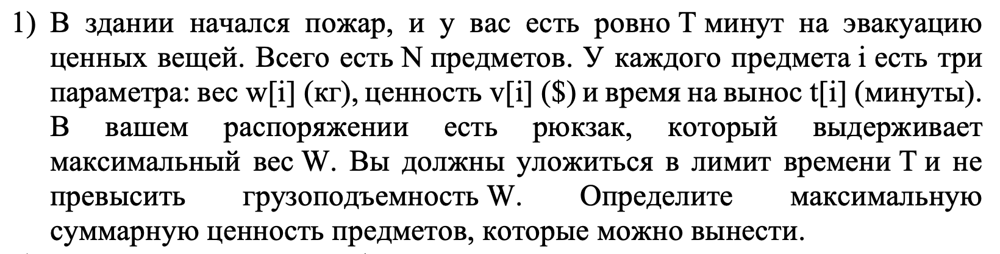
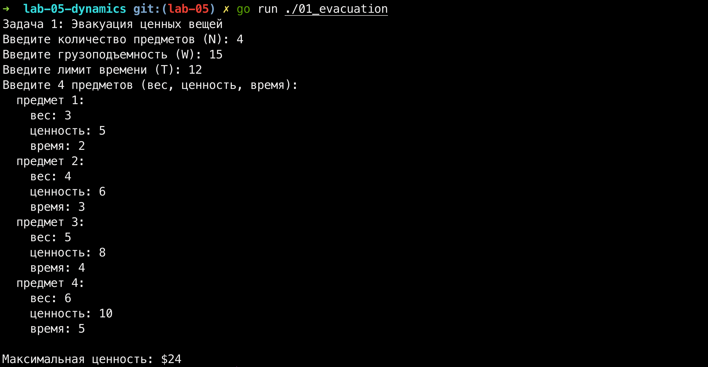
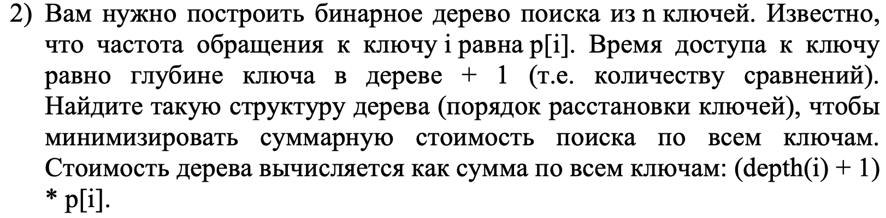
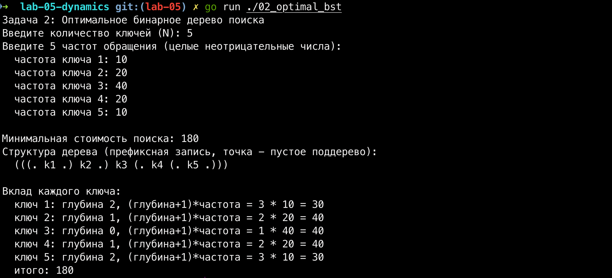
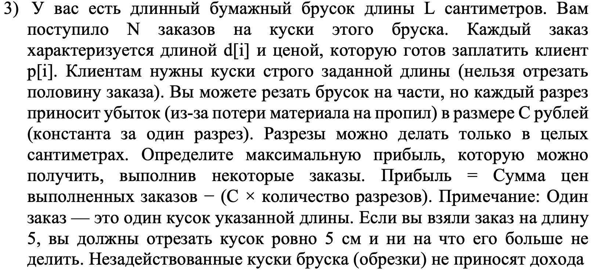
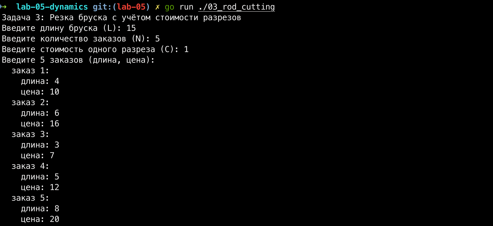
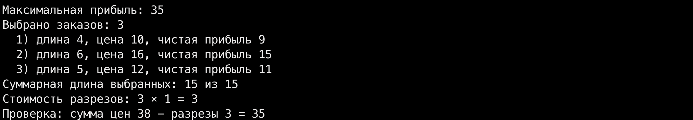

# Лабораторная работа №5. Динамическое программирование

## Введение

Тема этой лабы - динамическое программирование. В реальном бэкенде оно всплывает постоянно: когда надо раскидать задачи по воркерам, спланировать ресурсы сервера, оптимизировать кэш или грамотно порезать запросы по шардам. Короче, везде, где есть выбор из кучи вариантов с жесткими рамками, ДП выдает идеальный результат за вменяемое время. Жадные алгоритмы тут обычно проигрывают, а полный перебор просто вешает сервер.

В этой работе я разобрал три абсолютно разные задачи:
1. Эвакуация ценных вещей из горящего здания. Это двумерный рюкзак, где мы ограничены сразу по весу и по времени.
2. Оптимальное бинарное дерево поиска. Тут мы минимизируем общую стоимость поиска для ключей, зная, как часто к ним прилетают запросы.
3. Нарезка бумажного бруска, где каждый разрез платный. По сути, тот же рюкзак, но со штрафом, который мы хитро вшили прямо в цену заказа.

Весь проект написан на Go. Общие алгоритмы я вынес в отдельный пакет `internal/algo`, а файлы `main.go` в подпапках - это просто тонкие обертки для ввода и вывода данных через консоль. Такой подход избавляет от дублирования кода и полностью повторяет архитектуру нормальных коммерческих проектов.

## Структура проекта

- `internal/algo` - сердце всей лабы, чистые алгоритмы. Никакого ввода-вывода, только голая логика, которую при желании можно легко покрыть юнит-тестами.
- `01_evacuation/main.go`, `02_optimal_bst/main.go`, `03_rod_cutting/main.go` - точки входа. Их задача простая: прочитать `stdin`, пнуть алгоритм и напечатать красивый ответ.
- `img/` - папка со скриншотами условий и логов работы.

Разделение кода на пакеты сделано для того, чтобы алгоритмы не были привязаны к `os.Stdin`. Так мы можем спокойно менять интерфейс ввода-вывода, вообще не трогая математику ДП.

---

## 1. Основное задание

### 1.1 Задача 1. Эвакуация ценных вещей

**Условие:**

*Рисунок 1 - Условие задачи 1*

В здании начался пожар, и у нас есть ровно T минут на эвакуацию ценностей. Всего есть N предметов, для каждого известны вес w[i], ценность v[i] и время выноса t[i]. Наш рюкзак выдерживает максимум W кг. Нужно найти максимальную суммарную ценность предметов, которые мы успеем вынести, не порвав рюкзак и не сгорев по дороге.

**Решение:**
Перед нами классический рюкзак 0/1, но с одним подвохом - ограничения теперь два (и вес, и время). Значит, задача становится двумерной. Состояние dp[i][w][t] означает максимальную ценность, которую можно набрать, если перебрать первые i предметов, имея в запасе w килограмм и t минут. На каждом шаге мы либо забиваем на предмет, либо берем его (если он вообще влезает по лимитам). Итоговый ответ забираем из ячейки dp[N][W][T].

По времени это работает за O(N * W * T), по памяти - столько же. Да, память можно ужать до O(W * T), если хранить только прошлый слой, но для учебных тестов это лишнее усложнение кода, так что оставил трехмерную матрицу ради наглядности.

Чтобы отчет выглядел по-человечески, мало просто показать итоговую цифру стоимости - препод на защите явно спросит, какие именно вещи мы взяли. Поэтому я добавил обратный проход по матрице: стартуем с конца dp[N][W][T] и идем к началу. Если значение при переходе от слоя i-1 к слою i поменялось - значит, вещь i мы точно упаковали. Вычитаем ее вес и время из текущих лимитов и идем дальше. Если не поменялось - предмет остался лежать в здании.

**Код:**
[internal/algo/knapsack.go](internal/algo/knapsack.go)
[01_evacuation/main.go](01_evacuation/main.go)

**Вывод в терминале:**

*Рисунок 2 - Запуск задачи 1: N = 4, W = 15, T = 12, оптимальная ценность 24*

Прогнал тест: оптимумом оказались предметы 2, 3 и 4. Суммарный вес 4 + 5 + 6 = 15 впритык уложился в грузоподъемность, а время 3 + 4 + 5 = 12 идеально вбилось в лимит. Суммарная ценность получилась 6 + 8 + 10 = 24. Отличный пример, когда решение уперлось сразу в оба потолка.

---

### 1.2 Задача 2. Оптимальное бинарное дерево поиска

**Условие:**

*Рисунок 3 - Условие задачи 2*

Надо построить бинарное дерево поиска из n ключей. Частота обращения к каждому ключу равна p[i]. Время доступа к ключу - это его глубина в дереве плюс 1 (то есть сколько сравнений мы сделаем при спуске от корня). Нужно найти такую структуру дерева, чтобы минимизировать суммарную стоимость поиска по всем ключам: сумму (depth(i) + 1) * p[i].

**Решение:**
Это классическая задача об оптимальном BST (динамическое программирование на отрезках). Ключи у нас уже отсортированы, так что работаем чисто с частотами. Рекуррентная формула выглядит так:

cost[i][j] = sum(p[i..j]) + min по k из [i..j] ( cost[i][k-1] + cost[k+1][j] )

Здесь k - это индекс ключа, который мы пробуем сделать корнем поддерева для интервала от i до j. Слагаемое sum(p[i..j]) вылезает из-за того, что как только мы выбираем корень, всё остальное поддерево падает на один уровень вниз, а значит, каждая частота в нем добавляет к общей стоимости еще по одному сравнению. Если интервал пустой - стоимость равна нулю.

Чтобы не пересчитывать сумму частот sum(p[i..j]) каждый раз в глубоких циклах, я бахнул префиксные суммы. Теперь любая сумма на отрезке считается за O(1), что прилично ускоряет наш тройной цикл. Итоговая сложность по времени вышла O(n^3), по памяти - O(n^2). Существует крутая оптимизация Кнута-Морриса-Пратта через монотонность корня, которая сжимает время до O(n^2), но для нашей лабы я оставил базовый кубический вариант: код читается в разы проще, а на мелких объемах разницу в микросекундах никто не заметит.

Для сборки самого дерева завел отдельную матрицу root[i][j], куда сохраняю индексы лучших корней. После заполнения таблиц берём корень полного интервала root[1][n] и рекурсивно спускаемся в левое и правое поддеревья, собирая дерево.

**Код:**
[internal/algo/bst.go](internal/algo/bst.go)
[02_optimal_bst/main.go](02_optimal_bst/main.go)

**Вывод в терминале:**

*Рисунок 4 - Запуск задачи 2: N = 5, частоты 10, 20, 40, 20, 10, стоимость 180*

На тесте видно, что самый популярный ключ (с частотой 40) закономерно встал в корень дерева. Ключи 2 и 4 ушли на глубину 1, а редкие 1 и 5 упали на глубину 2. Общая стоимость: 3*10 + 2*20 + 1*40 + 2*20 + 3*10 = 180. Программа расписывает не только финальный результат, но и вклад каждого ключа в общую сумму. На защите это снимет у препода лишние вопросы.

---

### 1.3 Задача 3. Резка бруска с учётом стоимости разрезов

**Условие:**

*Рисунок 5 - Условие задачи 3*

У нас есть длинный бумажный брусок длины L см и N заказов. Каждый заказ - это кусок строго заданной длины d[i], за который клиент платит p[i] рублей. Мы можем резать брусок, но каждый пропил стоит C рублей убытка. Обрезки денег не приносят. Нужно выжать максимальную прибыль: Сумма цен выполненных заказов - (C × количество разрезов).

**Решение:**
Здесь есть важный нюанс, от которого зависит вся логика кода. Я исходил из того, что под каждый выполненный заказ мы делаем ровно один разрез, чтобы отделить кусок от бруска. Обрезки мы отдельно не кромсаем - они просто остаются лежать мусором. При таком раскладе чистая выгода с каждого заказа i - это просто p[i] - C. Единственное ограничение - общая длина кусков не должна превышать длину бруска L. В итоге задача красиво сводится к обычному рюкзаку 0/1 по длине бруска.

Заказы, у которых чистая прибыль уходит в минус или ноль (p[i] - C <= 0), я отсекаю еще на старте. Смысла брать их нет, они только сожрут место на бруске и уведут нас в минус. Зачем гонять ДП по заведомо мусорным данным?

По сложности мы получаем O(N * L) по времени и O(N * L) по памяти. Память, конечно, можно ужать до одномерного массива O(L), но я оставил двумерную матрицу состояний - так код читать гораздо легче.

**Код:**
[internal/algo/rod.go](internal/algo/rod.go)
[03_rod_cutting/main.go](03_rod_cutting/main.go)

**Вывод в терминале:**

*Рисунок 6 - Запуск задачи 3: ввод данных*

*Рисунок 7 - Запуск задачи 3: L = 15, N = 5, C = 1, максимальная прибыль 35*

Прогнал тест: брусок длиной 15, ценник за разрез - 1 рубль. На входе 5 заказов. Алгоритм выбрал заказы 1, 2 и 4. Суммарная длина получилась 4 + 6 + 5 = 15 (распилили брусок под ноль). Общая грязная цена вышла 10 + 16 + 12 = 38 рублей. Сделали три разреза - вычитаем 3 рубля, получаем чистую прибыль 35. Программа отдельно выводит грязную сумму, расходы на разрезы и финальный чек, чтобы препод видел, что дебет с кредитом сошелся.

---

## Заключение

Эта лабораторная отлично показала, как ДП работает на практике. В первой задаче у нас было два ограничения, поэтому состояние пришлось делать двумерным. Во второй задаче состоянием стал интервал ключей, а в циклах мы подбирали оптимальный корень. В третьей задаче мы вообще провернули бэкендерский трюк: зашили штраф за операцию прямо в цену заказа и легким движением руки свели задачу о резке к классическому рюкзаку.

Общий паттерн везде один: бьем задачу на подзадачи, завести таблицу состояний, заполняем ее снизу вверх (от мелких задач к крупным) и вытягиваем готовый ответ обратным ходом. В этом и есть весь кайф динамического программирования - мы не держим в памяти лишний перебор, но и не считаем одно и то же по два раза.

Логика, упакованная в пакет `internal/algo`, полностью себя оправдала. Код получился чистым, структурированным и готовым к любым проверкам на защите.

## Список использованных источников

1. Документация по языку программирования Go: https://go.dev/doc/
2. Лекционный курс по дисциплине "Углубленные структуры данных и алгоритмы", Университет ИТМО.
3. Адитья Бхаргава. Грокаем алгоритмы. Глава 11 "Динамическое программирование".
