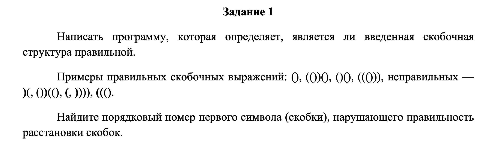
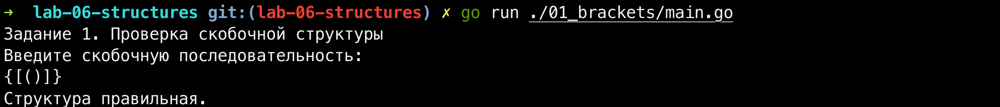
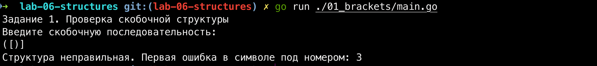
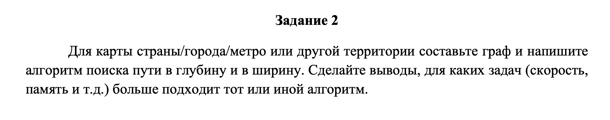
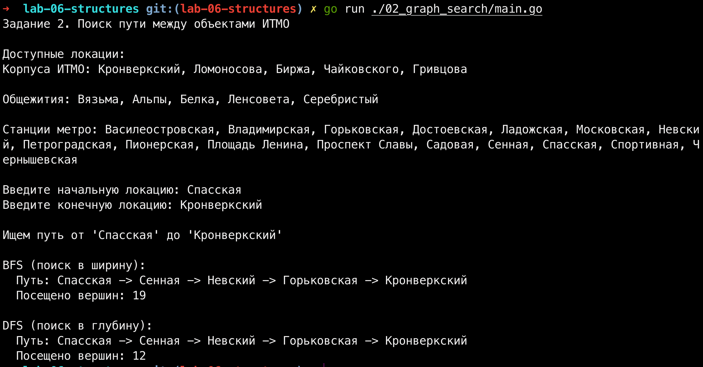

# Лабораторная работа №6. FIFO, LIFO, поиск в ширину и глубину

## Введение

Тема этой лабораторной работы - базовые структуры данных (стек и очередь) и алгоритмы обхода графов. В бэкенде это встречается повсеместно: от валидации JSON/HTML-тегов и парсинга математических выражений до построения маршрутов в логистике (как добраться из точки А в точку Б с минимальным числом пересадок).

В этой работе я разобрал две задачи:

1. Проверка правильности скобочной структуры с помощью стека (LIFO). Включая дополнительное задание с комбинациями `()`, `[]`, `{}`.
2. Поиск пути на графе реальной транспортной сети (корпуса и общежития ИТМО) с помощью поиска в ширину (BFS) и поиска в глубину (DFS).

Весь проект написан на Go. Общие алгоритмы я вынес в отдельный пакет `internal/algo`, а файлы `main.go` в подпапках - это просто тонкие обертки для ввода и вывода данных через консоль. Такой подход избавляет от дублирования кода и полностью повторяет архитектуру нормальных коммерческих проектов.

## Структура проекта

- `internal/algo` - чистая логика. Стек для скобок и алгоритмы обхода графа (BFS/DFS).
- `01_brackets/main.go` - точка входа для первого задания.
- `02_graph_search/main.go` - точка входа для второго задания.
- `img/` - папка со скриншотами условий и логов работы.

---

## 1. Задание 1. Проверка скобочной структуры (LIFO)

**Условие:**

**Решение:**
Задача решается классическим стеком, который работает по принципу **LIFO** (Last In, First Out - последним пришел, первым вышел). В Go стек реализован через срез.
При проходе по строке: если встречаем открывающую скобку - кладем её в стек (push). Если закрывающую - достаем верхнюю из стека (pop) и проверяем, совпадает ли она по типу.

Дополнительное задание выполнено: алгоритм использует словарь `pairs` для сопоставления трех типов скобок (`()`, `[]`, `{}`) и корректно находит индекс первой ошибки, если скобки пересекаются (например, `([)]`) или если в конце остались незакрытые скобки.

**Код:**
[internal/algo/brackets.go](internal/algo/brackets.go)
[01_brackets/main.go](01_brackets/main.go)

**Вывод в терминале (Успех):**

_Рисунок 1 - Проверка правильной комбинации `{[()]}`_

**Вывод в терминале (Ошибка):**

_Рисунок 2 - Поиск ошибки в структуре `([)]`. Программа верно указала на 3-й символ._

---

## 2. Задание 2. Поиск пути на графе (BFS и DFS)

**Условие:**

**Решение:**
Для моделирования карты я выбрал транспортную сеть метро Санкт-Петербурга: корпуса ИТМО, общежития и связывающие их станции метро. Граф представлен в виде списка смежности (`map[string][]string`).

- **BFS (Поиск в ширину):** использует **очередь (FIFO)**. Он исследует граф "слоями", сначала всех соседей первого уровня, потом второго и т.д. Это гарантирует, что найденный путь будет самым коротким по количеству пересадок (ребер).
- **DFS (Поиск в глубину):** использует **рекурсию (стек вызовов / LIFO)**. Он идет вглубь по одной ветке, пока не упрется в тупик, и только потом возвращается назад.

**Код:**
[internal/algo/graph.go](internal/algo/graph.go)
[02_graph_search/main.go](02_graph_search/main.go)

**Вывод в терминале:**

_Рисунок 3 - Поиск пути от станции "Спасская" до корпуса "Кронверкский"_

На данном тесте оба алгоритма нашли одинаковый маршрут (4 перегона), но с разной эффективностью.

BFS посетил 19 вершин, так как работает "слоями": чтобы перейти на следующий уровень, он должен проверить всех соседей текущего. Из-за высокой связности графа метро он проверил почти все станции, прежде чем гарантированно нашел кратчайший путь.

DFS посетил всего 12 вершин. Ему повезло: он нырнул вглубь по первой же ветке и сразу наткнулся на нужный маршрут. Однако, в отличие от BFS, DFS не гарантирует, что найденный путь будет самым коротким - при другом порядке обхода он мог бы уехать в тупик (например, в сторону «Альп») и потратить гораздо больше времени.

---

## 3. Выводы: сравнение BFS и DFS

По результатам работы и запуска программы видно, что для навигации по карте (поиска кратчайшего маршрута) **BFS подходит лучше**, чем DFS:

- **Скорость и оптимальность:** BFS гарантированно находит путь с минимальным количеством пересадок, так как проверяет все ближайшие варианты. DFS же ищет "вглубь" и находит _любой_ путь, который может оказаться очень длинным, если алгоритм свернет не в ту ветку.
- **Память:** В нашем примере DFS потратил меньше памяти (посетил 12 вершин против 19 у BFS). BFS хранит в очереди всех соседей текущего уровня, что на очень широких графах может потребовать много памяти. DFS хранит только текущую ветку (стек вызовов), поэтому на глубоких графах он экономичнее.

**Итог:**

- **BFS (FIFO)** - идеален для поиска кратчайшего пути по количеству пересадок (социальные сети, маршрутизаторы, карты).
- **DFS (LIFO)** - подходит для проверки связности графа, топологической сортировки, или поиска `любого` пути (например, лабиринт), когда важнее память, а не минимальное количество шагов.

---

## Заключение

Лабораторная показала, как базовые структуры данных (стек и очередь) решают разные задачи. Стек отлично справляется с вложенными структурами (скобки), а очередь - с поиском ближайших путей (BFS). Разделение логики по пакетам сделало код чистым и готовым к тестированию.

## Список использованных источников

1. Документация по языку программирования Go: https://go.dev/doc/
2. Лекционный курс по дисциплине "Углубленные структуры данных и алгоритмы", Университет ИТМО.
3. Адитья Бхаргава. Грокаем алгоритмы. Главы 3: Стек, 6: Поиск в ширину, 7: Деревья и поиск в глубину.
