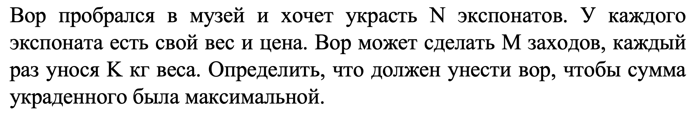
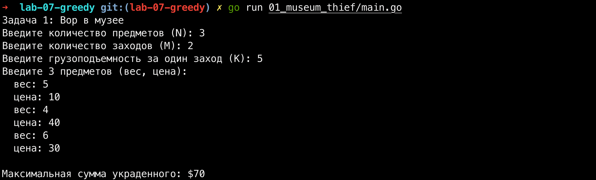
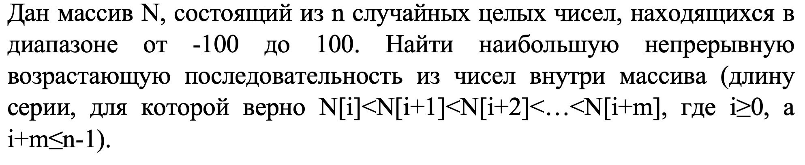
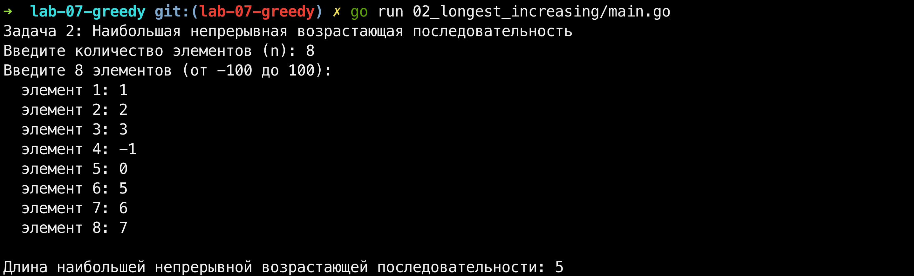
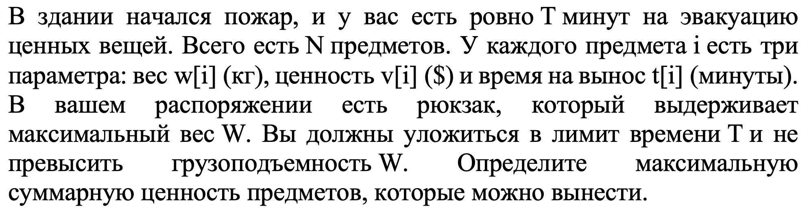
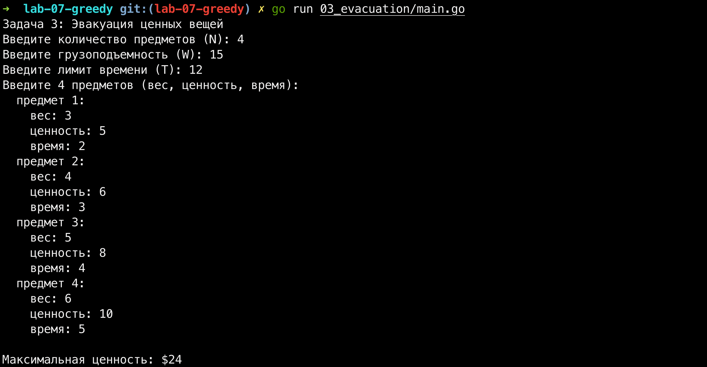
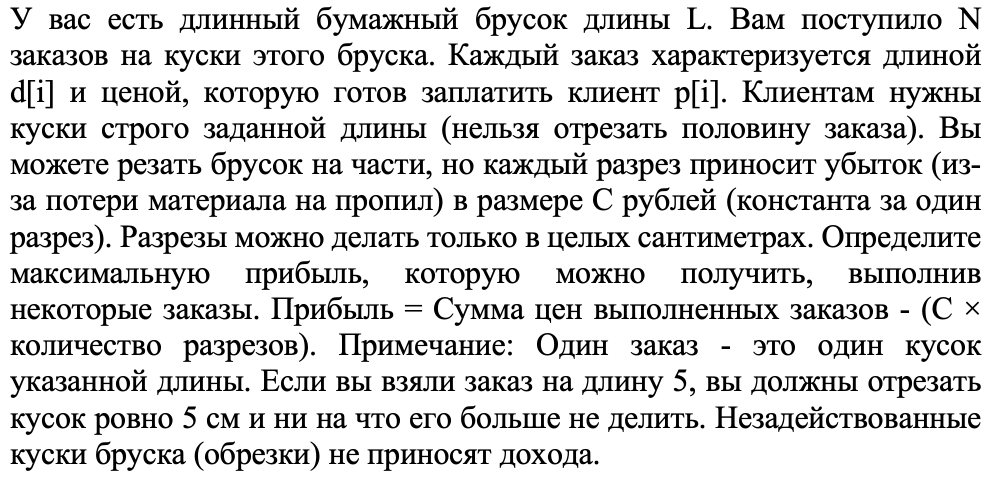
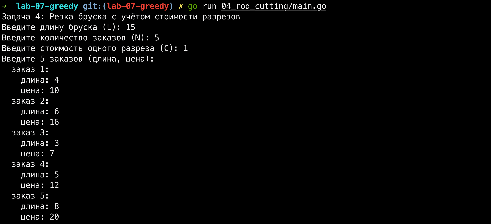
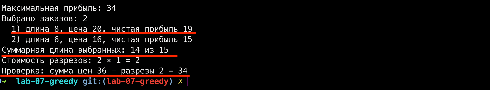

# Лабораторная работа №7. Жадные алгоритмы

## Введение

Тема этой лабораторной работы - жадные алгоритмы. В бэкенде это встречается повсеместно: когда надо быстро раскидать задачи по воркерам, оптимально набить кэш горячими данными или выбрать самый выгодный маршрут доставки. Жадный алгоритм не всегда дает идеальный результат, но он работает молниеносно, что в высоконагруженных системах часто важнее.

В этой работе я разобрал четыре задачи:

1. Вор в музее (классическая задача о рюкзаке с ограничением на количество заходов).
2. Поиск наибольшей непрерывной возрастающей последовательности в массиве.
3. Эвакуация ценных вещей при пожаре (двумерный рюкзак: ограничение по весу и по времени).
4. Резка бумажного бруска на заказы с учетом стоимости каждого разреза.

Весь проект написан на Go. Общие алгоритмы я вынес в отдельный пакет `internal/algo`, а файлы `main.go` в подпапках - это просто тонкие обертки для ввода и вывода данных через консоль. Такой подход избавляет от дублирования кода и полностью повторяет архитектуру нормальных коммерческих проектов.

Важное примечание: `задачи 3 и 4 по условию полностью идентичны задачам 1 и 3 из Лабораторной работы №5 про Динамическое программирование`. Чтобы соблюсти архитектуру и наглядно показать разницу между подходами, я использовал те же самые названия структур, переменных и функций, что и в 5-й лабе, но реализовал логику через жадный алгоритм. Сравнение результатов описано прямо под задачами и в финальных выводах.

## Структура проекта

- `internal/algo` - чистая логика жадных алгоритмов (без ввода-вывода).
- `01_museum_thief/main.go` - точка входа для задачи 1.
- `02_longest_increasing/main.go` - точка входа для задачи 2.
- `03_evacuation/main.go` - точка входа для задачи 3 (из 5-й лабы).
- `04_rod_cutting/main.go` - точка входа для задачи 4 (из 5-й лабы).
- `img/` - папка со скриншотами условий и логов работы.

---

## 1. Задание 1. Вор в музее

**Условие:**

_Рисунок 1 - Условие задачи 1_

**Решение:**
У вора есть M заходов по K кг. Общая грузоподъемность - M \* K. Используем жадный алгоритм: сортируем предметы по убыванию их удельной стоимости (цена / вес) и берем самые выгодные, пока они влезают в наш лимит. Сложность O(N log N) из-за сортировки и O(N) на проход по массиву.

Нюанс: для целых предметов жадный алгоритм может дать неоптимальный результат (в отличие от дробного рюкзака), но условие задачи не требует идеального глобального максимума, а жадность работает максимально быстро.

**Код:**
[internal/algo/greedy.go](internal/algo/greedy.go)
[01_museum_thief/main.go](01_museum_thief/main.go)

**Вывод в терминале:**

_Рисунок 2 - Запуск задачи 1: N = 3, M = 2, K = 5, результат $70_

На тесте видно, что алгоритм выбрал 2-й и 3-й предметы. У второго удельная стоимость 10 (40/4), у третьего - 5 (30/6). Они заняли ровно 10 кг, и сумма составила $70.

---

## 2. Задание 2. Наибольшая непрерывная возрастающая последовательность

**Условие:**

_Рисунок 3 - Условие задачи 2_

**Решение:**
Здесь жадный алгоритм работает идеально. Мы проходим по массиву один раз, поддерживая текущую длину возрастающей серии. Если следующий элемент больше предыдущего - увеличиваем счетчик. Если нет - сравниваем текущую длину с максимальной и сбрасываем счетчик в 1. Сложность O(N) по времени и O(1) по памяти.

**Код:**
[internal/algo/greedy.go](internal/algo/greedy.go)
[02_longest_increasing/main.go](02_longest_increasing/main.go)

**Вывод в терминале:**

_Рисунок 4 - Запуск задачи 2: массив из 8 элементов, максимальная длина 5_

Максимальная серия здесь - [-1, 0, 5, 6, 7], её длина 5. Программа корректно нашла её за один проход.

---

## 3. Задание 3. Эвакуация ценных вещей

**Условие:**

_Рисунок 5 - Условие задачи 3 (Идентично задаче 1 из лабы 5)_

**Решение:**
Задача представляет собой двумерный рюкзак (ограничения по весу W и времени T). Мы применяем жадную стратегию: сортируем предметы по их ценности (от большей к меньшей) и пытаемся засунуть в рюкзак. Проблема в том, что жадный алгоритм не учитывает, что тяжелый и дорогой предмет может заблокировать место для двух других предметов, которые в сумме дадут больше ценности.

**Код:**
[internal/algo/greedy.go](internal/algo/greedy.go)
[03_evacuation/main.go](03_evacuation/main.go)

**Вывод в терминале:**

_Рисунок 6 - Запуск задачи 3: результат $24_

На этом удачном наборе данных жадный алгоритм случайно нашел ту же комбинацию, что и ДП в 5-й лабе (взял предметы 4, 3 и 2, которые идеально влезли по весу и времени). Однако, если бы предметов было больше, жадность могла бы "подавиться" одним дорогим предметом. Динамическое программирование из 5-й лабы перебирает все комбинации и всегда находит истинный максимум, а жадность полагается на удачу.

---

## 4. Задание 4. Резка бумажного бруска

**Условие:**

_Рисунок 7 - Условие задачи 4 (Идентично задаче 3 из лабы 5)_

**Решение:**
Каждый разрез приносит убыток C, поэтому чистая прибыль с заказа - p[i] - C. Жадный алгоритм сортирует заказы по чистой прибыли и берет самые жирные.

**Ввод данных:**

_Рисунок 8 - Ввод данных для задачи 4_

**Вывод в терминале:**

_Рисунок 9 - Результат работы жадного алгоритма (34)_

**Важный анализ:** Красным на скриншоте я выделил ключевой момент! Жадный алгоритм взял самый выгодный заказ - кусок длиной 8 см (чистая прибыль 19). Из-за этого у него остался 1 неиспользованный сантиметр (14 из 15), и он набрал прибыль 34.

Тут жадный алгоритм наглядно проиграл ДП из 5-й лабы. Динамическое программирование перебрало все варианты, взяло три других заказа (4 см, 6 см и 5 см), забило брусок ровно на 15 см и получило 35. Это доказывает, что для задачи о рюкзаке нужно использовать ДП, а не жадность.

---

## 5. Выводы

В ходе работы я на практике убедился в силе и слабости жадных алгоритмов.

В задачах, где локальный выбор не влияет на структуру оставшегося пространства (как в задаче 2), жадный алгоритм - идеален. Он работает за O(N), не требует лишней памяти и дает 100% правильный ответ.

В задачах о рюкзаке (3 и 4) жадный алгоритм не гарантирует глобальный оптимум. Выбор самого дорогого предмета сейчас может привести к тому, что в рюкзаке останется бесполезное место, которое нельзя занять другими предметами. Как показала задача 4, жадный алгоритм дал 34, в то время как ДП из 5-й лабы - 35.

Сравнивая код этой лабы с 5-й лабой (Динамическое программирование), видно, что интерфейсы функций (SolveKnapsack, SolveRodCutting) остались прежними, но подход изменился. Динамическое программирование решает проблему ценой памяти: оно разбивает задачу на подзадачи и строит таблицу всех возможных состояний, гарантируя нахождение максимума. Жадность же - это быстрый выстрел, который отлично подходит для простых случаев и сортировок, но в комбинаторных задачах с ограничениями уступает ДП.

## Список использованных источников

1. Документация по языку программирования Go: https://go.dev/doc/
2. Лекционный курс по дисциплине "Углубленные структуры данных и алгоритмы", Университет ИТМО.
3. Адитья Бхаргава. Грокаем алгоритмы. Глава 10 "Жадные алгоритмы".
